<picture><source media="(prefers-color-scheme: dark)" srcset="assets/hero-dark.svg"></picture>

<picture><source media="(prefers-color-scheme: dark)" srcset="assets/about-dark.svg"></picture>

<picture><source media="(prefers-color-scheme: dark)" srcset="assets/stack-dark.svg"></picture>

<a href="https://github.com/elvs18/adaptation"><picture><source media="(prefers-color-scheme: dark)" srcset="assets/project-adaptation-dark.svg"></picture></a>&nbsp;<a href="https://github.com/elvs18/diplom-work"><picture><source media="(prefers-color-scheme: dark)" srcset="assets/project-diplom-work-dark.svg"></picture></a>

<a href="https://github.com/elvs18/landing"><picture><source media="(prefers-color-scheme: dark)" srcset="assets/project-landing-dark.svg"></picture></a>&nbsp;<a href="https://github.com/elvs18/signup"><picture><source media="(prefers-color-scheme: dark)" srcset="assets/project-signup-dark.svg"></picture></a>

<picture><source media="(prefers-color-scheme: dark)" srcset="assets/stats-dark.svg"></picture>

<picture><source media="(prefers-color-scheme: dark)" srcset="assets/streak-dark.svg"></picture>

<picture><source media="(prefers-color-scheme: dark)" srcset="assets/wave-dark.svg"></picture>

<a href="https://github.com/elvs18?tab=repositories"><picture><source media="(prefers-color-scheme: dark)" srcset="assets/button-1-dark.svg"></picture></a>&nbsp;&nbsp;<a href="https://github.com/elvs18"><picture><source media="(prefers-color-scheme: dark)" srcset="assets/button-2-dark.svg"></picture></a>

<a href="https://metawka.github.io/expressive-profile/?from=elvs18"><picture><source media="(prefers-color-scheme: dark)" srcset="assets/credit-dark.svg"></picture></a>

